# EBank-ms-app — Partie 1 : Architecture Microservices

## 1. Présentation du projet

Cette première partie du projet consiste à développer une application bancaire basée sur une architecture microservices avec Spring Boot et Spring Cloud.

L'application est composée de quatre services indépendants : Customer-Service, EBank-Service, Gateway-Service et Discovery-Service. Les deux premiers assurent la gestion des clients et des comptes bancaires. Le Gateway permet d'accéder aux services à travers un point d'entrée unique, tandis qu'Eureka assure leur découverte.

La communication entre les microservices est réalisée avec OpenFeign. Resilience4J est utilisé pour mettre en place un mécanisme de tolérance aux pannes basé sur le Circuit Breaker et une méthode de fallback.

## 2. Objectifs de la partie 1

Les objectifs définis dans l'énoncé sont les suivants :

- Développer le microservice Customer-Service.
- Développer le microservice EBank-Service.
- Assurer la communication entre les deux services avec OpenFeign.
- Mettre en place la tolérance aux pannes avec Resilience4J et le Circuit Breaker.
- Développer une Gateway pour le routage des requêtes.
- Développer un Discovery Service avec Eureka.
- Tester les services backend avec un client REST, notamment Postman, et avec Swagger UI.

## 3. Architecture du projet (Partie 1)

L'application est organisée en quatre modules indépendants.

| Service | Port | Rôle |
|---|---:|---|
| Customer-Service | 8056 | Gestion des clients |
| EBank-Service | 8057 | Gestion des comptes bancaires |
| Discovery-Service | 8761 | Enregistrement et découverte des services avec Eureka |
| Gateway-Service | 9999 | Point d'entrée et routage des requêtes |

### Architecture partie 1

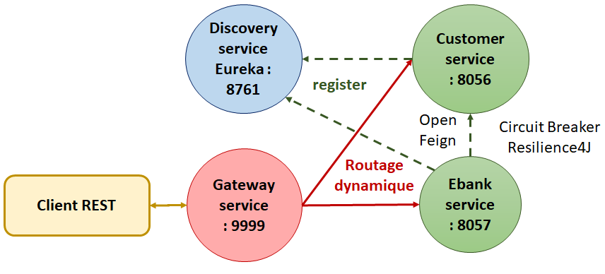


Discovery-Service permet aux services de s'enregistrer auprès d'Eureka. Gateway-Service utilise la découverte des services pour effectuer le routage dynamique. EBank-Service utilise OpenFeign pour récupérer les informations du client associé à un compte bancaire.

## 4. Technologies utilisées

- **Java 21** : langage de programmation.
- **Spring Boot** : création des microservices et des API REST.
- **Spring Web** : développement des contrôleurs REST.
- **Spring Data JPA** : gestion de la persistance des entités.
- **H2 Database** : bases de données en mémoire.
- **Lombok** : réduction du code répétitif des entités Java.
- **Spring Cloud Gateway** : routage des requêtes.
- **Spring Cloud Netflix Eureka** : découverte et enregistrement des services.
- **Spring Cloud OpenFeign** : communication déclarative entre microservices.
- **Resilience4J** : tolérance aux pannes avec le Circuit Breaker et le fallback.
- **Springdoc OpenAPI / Swagger UI** : documentation et test des API REST.
- **Maven** : gestion des dépendances et construction du projet.
- **IntelliJ IDEA** : environnement de développement.

## 5. Étapes de réalisation

### 5.1. Création du projet principal

Le projet principal `EBank-ms-app` a été créé dans IntelliJ IDEA sans dépendances initiales. Les différents services ont ensuite été ajoutés sous forme de modules indépendants afin de séparer les responsabilités de l'application.

### 5.2. Développement de Customer-Service

Customer-Service constitue le premier microservice développé. Il assure la gestion des clients et expose des endpoints REST pour accéder à leurs informations.

Les principales étapes de réalisation sont :

1. Création du module Customer-Service.
2. Création des packages `entities`, `repositories`, `service` et `controller`.
3. Création de l'entité `Customer` avec ses annotations JPA et Lombok.
4. Création de `CustomerRepository`, qui étend `JpaRepository<Customer, Long>`.
5. Développement de la couche service pour regrouper les opérations métier et utiliser le repository.
6. Création de `CustomerRestController` pour exposer les endpoints REST.
7. Initialisation de quelques clients de test au démarrage de l'application.
8. Configuration du port et de la base de données H2 dans `application.properties`.
9. Ajout de la dépendance de documentation API afin d'utiliser Swagger UI.

Le service utilise une base H2 en mémoire nommée `customer-db` et fonctionne sur le port `8056`.

Principaux endpoints :

| Méthode | Endpoint | Description |
|---|---|---|
| GET | `/customers` | Récupérer la liste des clients, si cet endpoint est exposé |
| GET | `/customers/{id}` | Récupérer un client par son identifiant |

### 5.3. Développement d'EBank-Service

Le deuxième module, EBank-Service, assure la gestion des comptes bancaires.

Les étapes de réalisation reprennent l'organisation en couches appliquée au premier service :

1. Création du module EBank-Service.
2. Création des packages nécessaires, notamment `entities`, `repositories`, `service` et `controller`.
3. Création de l'entité `BankAccount` et de ses attributs.
4. Création de `BankAccountRepository` pour accéder aux comptes bancaires.
5. Développement de la couche service pour gérer les opérations sur les comptes.
6. Création du contrôleur REST pour exposer les endpoints.
7. Initialisation de données de test et configuration de la base H2.
8. Configuration du port `8057` et ajout des dépendances nécessaires.

Une classe `Customer` est également créée dans le package `model` d'EBank-Service. Contrairement à l'entité `Customer` de Customer-Service, cette classe représente les informations du client reçues à distance. Elle n'est pas une entité JPA et ne correspond pas à une table de la base de données d'EBank-Service.

L'objet client est associé à `BankAccount` pour pouvoir retourner les informations du client avec celles du compte. L'annotation `@Transient` permet à JPA d'ignorer cet attribut lors de la persistance de l'entité bancaire.

Le service utilise une base H2 en mémoire nommée `accounts-db`.

Principales opérations :

- Récupération de la liste des comptes bancaires, si l'endpoint correspondant est exposé.
- Recherche d'un compte par son identifiant.
- Création et enregistrement d'un compte bancaire.
- Récupération des informations du client associé au compte grâce à OpenFeign.

### 5.4. Création de Gateway-Service et configuration du routage statique

Gateway-Service a été créé pour fournir un point d'entrée unique vers les microservices.

Dans un premier temps, le routage statique a été configuré dans `application.yml`. Chaque route possède un identifiant, une URI de destination et un prédicat `Path`.

Les routes initiales redirigent les requêtes vers les services correspondants :

- `/customers/**` vers Customer-Service sur le port `8056`.
- `/accounts/**` vers EBank-Service sur le port `8057`.

Cette première configuration utilise directement les adresses des services. Elle constitue donc un routage statique.

### 5.5. Création de Discovery-Service avec Eureka

Afin de permettre la découverte dynamique des services, un quatrième module, Discovery-Service, a été ajouté.

Le serveur Eureka est activé avec `@EnableEurekaServer`. Sa configuration principale dans `application.properties` est la suivante :

```properties
spring.application.name=discovery-service
server.port=8761
eureka.client.register-with-eureka=false
eureka.client.fetch-registry=false
```

Les propriétés `register-with-eureka=false` et `fetch-registry=false` indiquent que le serveur Eureka ne s'enregistre pas lui-même comme client et ne récupère pas le registre comme le ferait un client Eureka.

Les services Customer-Service, EBank-Service et Gateway-Service sont ensuite configurés pour utiliser Eureka. La découverte doit être activée et l'adresse du serveur Eureka doit être renseignée dans leur configuration.

Le tableau de bord est accessible à l'adresse :

`http://localhost:8761`

Il permet de vérifier l'enregistrement des services dans le registre Eureka.

### 5.6. Mise en place du routage dynamique

Après la configuration du Discovery Service, le routage dynamique a été mis en place dans Gateway-Service.

La configuration des routes statiques a été commentée pour utiliser la découverte des services enregistrés dans Eureka. Une instance de `DiscoveryClientRouteDefinitionLocator` est déclarée dans la classe principale de Gateway-Service :

```java
@Bean
DiscoveryClientRouteDefinitionLocator routes(
        ReactiveDiscoveryClient rdc,
        DiscoveryLocatorProperties dp) {
    return new DiscoveryClientRouteDefinitionLocator(rdc, dp);
}
```

Le mécanisme de découverte permet alors à la Gateway de créer des routes à partir des services enregistrés. Les noms de services sont utilisés dans les URL, par exemple :

- `http://localhost:9999/CUSTOMER-SERVICE/customers/1`
- `http://localhost:9999/EBANK-SERVICE/accounts/{id}`

Cette configuration évite de dépendre uniquement de routes écrites manuellement vers des adresses fixes.

### 5.7. Communication entre microservices avec OpenFeign

OpenFeign a été ajouté à EBank-Service pour permettre à ce dernier d'appeler Customer-Service sans construire manuellement les requêtes HTTP.

Une interface `CustomerRestClient` a été créée dans le package `feign`. Elle déclare l'appel vers l'endpoint de récupération d'un client :

```java
@FeignClient(name = "customer-service")
public interface CustomerRestClient {

    @GetMapping("/customers/{id}")
    Customer getCustomerById(@PathVariable Long id);
}
```

Le nom logique `customer-service` permet à OpenFeign de localiser le service à l'aide du mécanisme de découverte configuré.

La fonctionnalité OpenFeign est activée dans l'application EBank-Service avec `@EnableFeignClients`.

Lorsqu'un compte bancaire est récupéré, la couche service peut appeler `CustomerRestClient` pour obtenir les informations du client associé et les inclure dans la réponse.

Cette communication conserve la séparation des responsabilités : Customer-Service gère les clients, tandis qu'EBank-Service gère les comptes bancaires.

### 5.8. Mise en place de Resilience4J

Resilience4J a été ajouté à EBank-Service pour améliorer la tolérance aux pannes lors des appels vers Customer-Service.

Le Circuit Breaker vise à limiter les appels vers un service qui rencontre des défaillances. Une méthode de fallback a également été définie pour fournir des informations par défaut lorsque les conditions de repli sont réunies.

Exemple de la méthode déclarée dans `CustomerRestClient` :

```java
@FeignClient(name = "customer-service")
public interface CustomerRestClient {

    @GetMapping("/customers/{id}")
    @CircuitBreaker(
        name = "customerService",
        fallbackMethod = "getDefaultCustomer"
    )
    Customer getCustomerById(@PathVariable Long id);

    default Customer getDefaultCustomer(Long id, Exception e) {
        return new Customer(id, "NoName", "NoEmail");
    }
}
```

En cas d'échec couvert par le mécanisme de repli, la méthode retourne un objet `Customer` avec les valeurs `NoName` et `NoEmail`.

Le comportement effectif dépend de la configuration et de l'intégration de Resilience4J. Le fallback doit donc être vérifié en provoquant une indisponibilité de Customer-Service et en contrôlant la réponse d'un endpoint d'EBank-Service qui appelle réellement `CustomerRestClient`.

## 6. Configuration et lancement de l'application

Les quatre applications doivent être lancées séparément dans IntelliJ IDEA.

Ordre de démarrage recommandé :

1. **Discovery-Service** : port `8761`.
2. **Customer-Service** : port `8056`.
3. **EBank-Service** : port `8057`.
4. **Gateway-Service** : port `9999`.

Après le démarrage, il faut vérifier que les services apparaissent dans le tableau de bord Eureka avant de tester le routage dynamique.

Les bases de données H2 sont configurées en mémoire. Les données de test peuvent donc être réinitialisées lors du redémarrage des applications.

## 7. Tests et résultats

Les tests suivants permettent de vérifier le fonctionnement des différents composants. Les captures d'écran correspondantes sont regroupées dans le dossier `screenshots/`.

### 7.1. Tests du routage statique

#### Routage vers EBank-Service

URL : `http://localhost:9999/accounts`

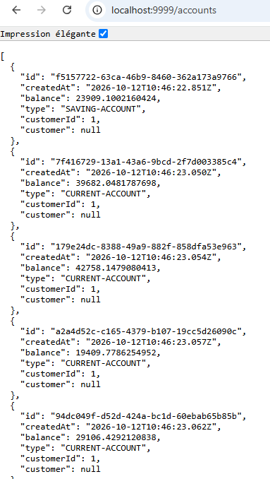

#### Routage vers Customer-Service

URL : `http://localhost:9999/customers`

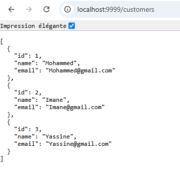

### 7.2. Découverte des services avec Eureka

URL : `http://localhost:8761`

Cette capture permet de vérifier l'enregistrement des microservices et du Gateway dans le registre Eureka.

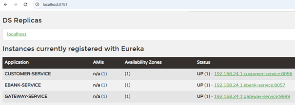

### 7.3. Tests du routage dynamique

#### Accès à Customer-Service

URL : `http://localhost:9999/CUSTOMER-SERVICE/customers/1`

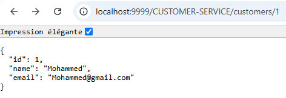

#### Accès à EBank-Service

URL : `http://localhost:9999/EBANK-SERVICE/accounts/{id}`

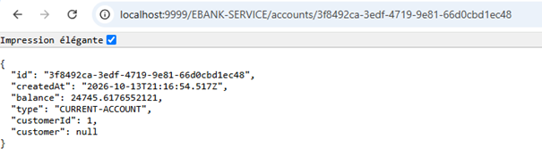

### 7.4. Tests directs de Customer-Service

#### Liste des clients

URL : `http://localhost:8056/customers`

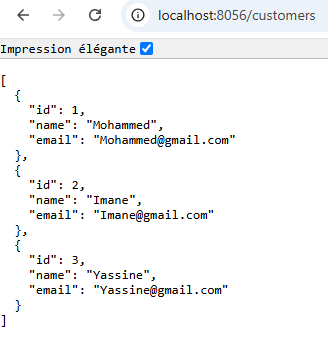

#### Recherche d'un client par identifiant

URL : `http://localhost:8056/customers/1`

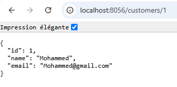

### 7.5. Tests directs d'EBank-Service

#### Liste des comptes bancaires

URL : `http://localhost:8057/accounts`

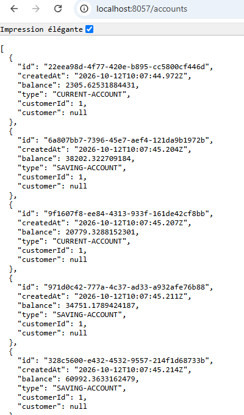

#### Recherche d'un compte bancaire par identifiant

URL : `http://localhost:8057/accounts/{id}`

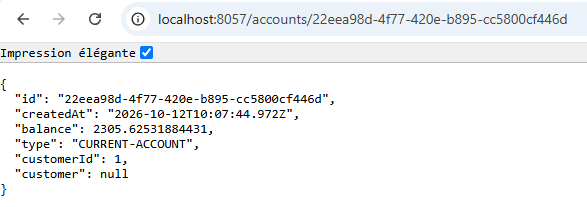

L'identifiant présenté doit correspondre à un compte existant dans les données de test.

### 7.6. Vérification de la communication avec OpenFeign

URL : `http://localhost:9999/EBANK-SERVICE/accounts/{id}`

Cette requête permet de vérifier la récupération d'un compte bancaire et, si l'appel OpenFeign est exécuté par la couche service, l'affichage des informations du client associé.

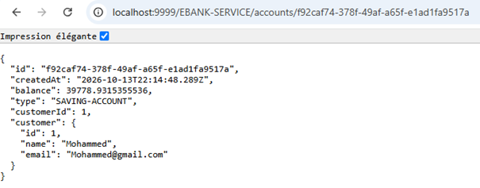

### 7.7. Vérification du fallback Resilience4J

URL : `http://localhost:9999/EBANK-SERVICE/accounts/{id}`

Pour ce test, Customer-Service est arrêté temporairement tandis qu'EBank-Service, Gateway-Service et Discovery-Service restent démarrés.

L'objectif est de vérifier que l'appel vers Customer-Service est géré par le mécanisme de tolérance aux pannes et que les informations par défaut, notamment `NoName` et `NoEmail`, sont retournées lorsque le fallback est effectivement déclenché.

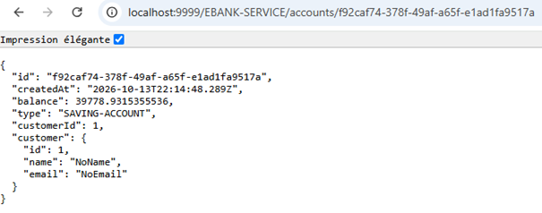

### 7.8. Documentation des API avec Swagger UI

#### Customer-Service

URL : `http://localhost:8056/swagger-ui/index.html`

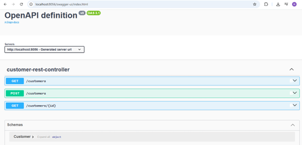

#### EBank-Service

URL : `http://localhost:8057/swagger-ui/index.html`

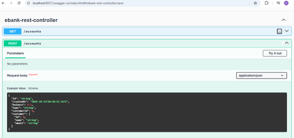

Swagger UI permet de consulter les endpoints disponibles et, selon leur configuration, d'exécuter directement des requêtes sur les API REST.

## 8. Historique des commits

Les principales étapes de réalisation sont retracées dans l'historique Git :

1. `Initial commit: Initialize the project and create the customer-service module.`
2. `Implement customer service`
3. `Implement EBank service`
4. `Implement gateway service with routing configuration`
5. `Implement discovery service`
6. `Implement dynamic gateway routing and OpenFeign client`
7. `Integrate OpenFeign client into EBank service`
8. `Add Resilience4j circuit breaker with fallback for Customer service`
9. `Add screenshots of microservices tests`

## 9. Conclusion

Cette première partie a permis de mettre en place une architecture microservices pour une application bancaire. Customer-Service et EBank-Service assurent la séparation des responsabilités métier, tandis que Gateway-Service fournit un point d'entrée commun et que Discovery-Service facilite la découverte des services.

OpenFeign permet la communication entre les microservices, et Resilience4J apporte un mécanisme destiné à gérer les défaillances des appels distants. Enfin, les tests REST et la documentation Swagger UI permettent de vérifier et d'explorer les API développées.

Cette architecture constitue une base pour la suite du projet, qui pourra compléter les fonctionnalités métier et approfondir les mécanismes de résilience et de validation.
